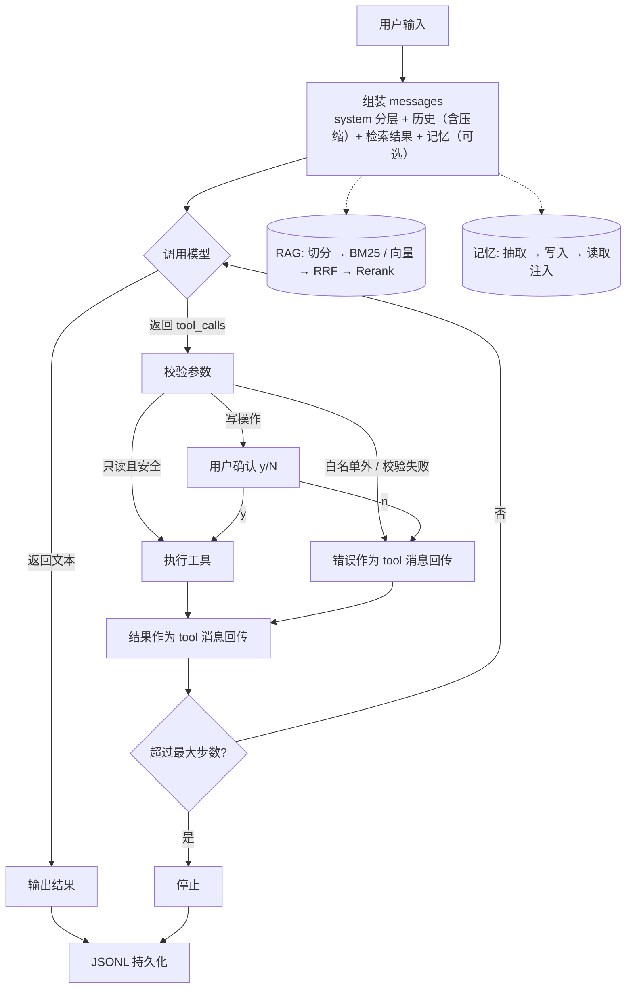
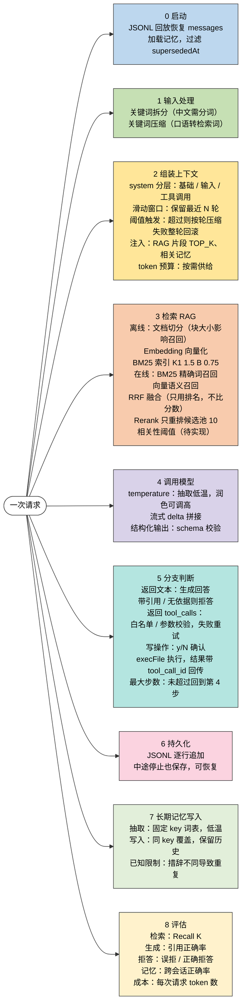

# Agent 整体流程与知识地图

对应模块：一（Day 1–10）、二（Day 11–14）、可选的长期记忆。大纲版本见 [agent-outline.md](./agent-outline.md)。

## 一、整体流程

## 二、知识地图

## 三、学习重点

1. Agent 循环：tool_calls 必须原样回传，必须限制步数
2. 上下文：按轮压缩，失败整轮回滚
3. 结构化输出：合法 JSON 不等于字段正确
4. 工具安全：白名单、参数校验、人工确认，安全在应用层
5. RAG 质量：切分、召回、拒答需要一起评估
6. 混合检索：BM25 与向量互补，RRF 融合的是排名而不是分数
7. Rerank：无法召回候选池之外的内容

## 四、尚未闭环

- Day 14 候选池实验（CANDIDATES=20）已跳过
- 记忆去重问题记为已知限制（措辞不同导致重复或误覆盖）
- Module 1 遗留：复现"长对话爆上下文"
